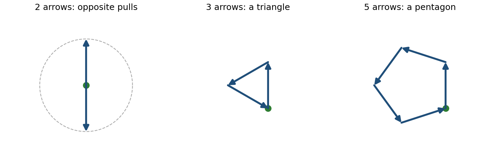
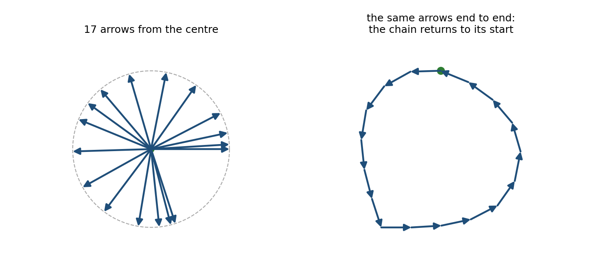
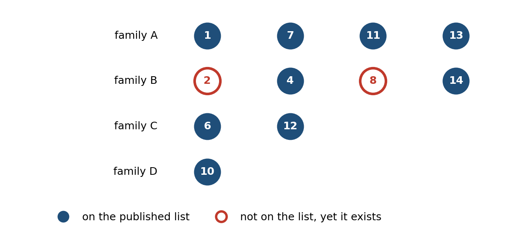
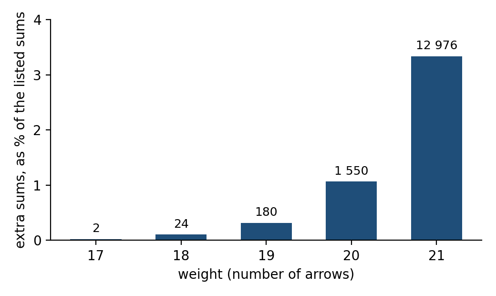

DOI of this text: [doi:10.5281/zenodo.24576582](https://doi.org/10.5281/zenodo.24576582)

This is an introductory text to the research paper *Missing types in the conjectural classification of minimal vanishing sums of roots of unity of weights 17 to 21* [Per26], by the same author. The paper has the proofs and the full computations. This note has the idea. No equations are needed to follow it. It makes no claim the paper does not make, and it says which claims are proved and which are only computed.

# Arrows that cancel

Draw a circle and mark on it points that are spaced evenly, like the hours on a clock face. Each point is a **root of unity**. Now draw an arrow of length one from the centre to a point. A set of such arrows pushes in several directions at once, and we can ask where the pushes add up. Put the arrows head to tail, one after the other. If the chain ends exactly where it began, the pushes have cancelled. We say the arrows form a **vanishing sum**.

Small examples are easy. Two arrows pointing in opposite directions cancel. Three arrows spaced a third of a turn apart close up into a triangle. Five arrows spaced a fifth of a turn apart close up into a pentagon.

{width=95%}

Some cancellations are only two smaller ones glued together. Add an opposite pair to a triangle and the five arrows still cancel, but you could have stopped after the pair. We call a vanishing sum **minimal** when it has no such shortcut: no smaller group of its arrows already cancels by itself. The number of arrows is its **weight**. The pair, the triangle and the pentagon are minimal, of weights 2, 3 and 5.

The question is simple to ask. **What are all the minimal ways to cancel, for each weight?** Minimal vanishing sums arise in the study of cyclotomic fields, in combinatorics and in geometry, so a complete list is useful.

# A list, part by part proved and part guessed

Mathematicians have worked on this list for sixty years, weight after weight. Christie, Dykema and Klep [CDK] classified every minimal vanishing sum up to weight 16, by hand. Their proof does not use a computer. To keep the list short they describe a sum by its **type**, a recipe for building it. A recipe says, for example: take seven small groups of arrows, turn them by seven evenly spaced turns, and choose the groups so that all seven have the same total. Then the seven turned totals cancel, because seven evenly spaced arrows cancel. In the example of this note, six of the seven groups are pairs of arrows and the seventh group has five arrows, chosen to have the same total as a pair. That makes 17 arrows in all, six pairs and five more.

Beyond weight 16 the authors used a computer program to produce a table of types for weights 17 to 21. They say clearly that this table is **conjectural**. Their program was written by hand, it was not formally verified, and it tests whether a sum vanishes with ordinary decimal arithmetic, which can round. Their table has 51 types at weight 17.

The table is nevertheless used. Later papers cite the classification up to weight 20 or 21. We do not claim that anything in those papers is wrong. We say only that results which rest on the table for weights 17 to 21 may need rechecking, and that is why a precise check is worth doing.

# Two sums that are not on the list

Our paper does three things. The first is the most concrete. We found two minimal vanishing sums of weight 17 that are **not on the list**. Each is built from the 210th roots of unity, that is, a circle cut into 210 equal steps, and each uses 17 different arrows. Here is one of them.

{width=95%}

That it cancels is not a numerical impression. The paper **proves by hand** that both sums vanish and are minimal, using one general fact from the Christie, Dykema and Klep paper and the classification of sums of weight at most 7. The same two facts have also been **checked by computer in Lean**, a program that verifies a proof line by line, over all 131 070 smaller groups of arrows. So these two sums exist, and the table has no type for them.

# Why the list must have a gap

The second result is a short argument, and it is also **proved**. It does not use the computer search at all, only the two sums above.

There is a hidden symmetry. Take any vanishing sum and multiply the angle of every arrow by the same whole number, one that shares no factor with 210 (the number of steps on the circle). The arrows move, but they still cancel, they still have no shortcut, and there are still 17 of them. Mathematicians call this the Galois action. It follows that a complete list must come in families: if one sum is on it, so is every sum obtained this way.

The table fails this test. Its types that have the shape of the sums above can be grouped into four families. Three families are complete on the list. The fourth family has four members, and the table has only two of them. Each of the two missing sums belongs to a family of which the table does contain a member, so the table cannot be complete.

{width=70%}

This is a good habit in general. If a list is claimed to be complete, check it against its own symmetries. It is cheap, and here it settles weight 17 without any search.

# Where the gaps come from

The third result is a computation, and it is labelled **computed**. We wrote a new search from scratch. It uses only two known facts, works in exact whole-number arithmetic, imports none of the authors' code, and checks every sum it finds with a separate verifier. Run on weights 2 to 16, it reproduces the proved classification exactly. That is our test that the search is sound.

At weights 17 to 21 it finds every sum in the table (after the minimality filter of the authors' own program), plus extra ones. The table's list of sums at weight 17 has 8258 rotation classes. Ours has 8260. The paper gives the same comparison up to weight 21, with a count of the extra sums in each row.

{width=70%}

Then we read the released program to see why it loses them. In the computed result there are three causes, and one case where two of them act together.

- **One version kept, two exist.** A building block of weight 7 comes in two genuinely different versions, neither a turn nor a mirror image of the other. The program stores only one. This is the cause of the two sums above, and of 32 new types in all.
- **One way to place the pieces.** Some groups are built from two smaller cancelling pieces, and those pieces can be placed on the circle in several ways. In one example of the paper, 4 of 12 placements work. The program tries one fixed placement, which is one of those that do not work, and drops the type. This is the cause of 42 new types.
- **Half a circle only.** For groups of three arrows, the program looks only at those lying in half a circle. That loses 18 types, first seen at weight 21.
- **Both of the first two together.** Four more types at weight 21 need both fixes at once.

In total, **96 new types and 14 732 extra sums at weights 17 to 21**. The symmetry check of the previous section would find many of these, but not all: 35 of the 96 types, with 9016 of the sums, have no listed relative at all, so a symmetry check on the table would pass them. Only an exhaustive search finds them. The paper explains what a corrected program must do: never rely on a single stored version, try every placement, and look at the whole circle.

# What this note claims, and what it does not

**Proved, by hand:** the two weight 17 sums vanish and are minimal, and the table is not complete at weight 17. **Checked by computer in Lean:** the two sums vanish and are minimal. **Computed:** the counts at weights 17 to 21, the 96 new types and the three causes. The search is exact, but its completeness depends on our code being correct. We have not formally verified that code, and a second independent version would strengthen the result. So the counts are lower bounds, not a final classification.

We do not claim that the 8260 sums are all the minimal vanishing sums of weight 17. We do not claim the table is wrong outside weight 17, or that the classification up to weight 16 is wrong, since that part is proved by hand. We know of no earlier note of the omission, in the sources we could consult, and the paper lists those it could not read. If a reader shows it is already known, the paper will be corrected and credit given.

# Why it matters

A classification is a tool: others build on it. A table that is called conjectural, and used all the same, can quietly carry a gap. Here the gap is small at weight 17 and grows with weight, to about one extra sum for every thirty listed at weight 21. The result also shows a method that costs little: check a list against its own symmetries, then confirm with a search that does not share the list's code. It also shows how a program can lose answers without any error message, by keeping one version of something that has two.

# Where to go next

- The paper itself [Per26], with the proofs, the tables and the commands to rerun every computation.
- The classification we checked [CDK].

# References {-}

[CDK] L. Christie, K. J. Dykema, I. Klep, *Classifying minimal vanishing sums of roots of unity*, arXiv:2008.11268 (v2, December 2025), [doi:10.48550/arXiv.2008.11268](https://doi.org/10.48550/arXiv.2008.11268).

[Per26] M. Perreault, *Missing types in the conjectural classification of minimal vanishing sums of roots of unity of weights 17 to 21*, 2026, Zenodo. [doi:10.5281/zenodo.24562183](https://doi.org/10.5281/zenodo.24562183).

```{=latex}
\par\ifdim\dimexpr\pagegoal-\pagetotal\relax<15\baselineskip\ifdim\pagetotal>0pt\newpage\fi\fi
```

# Use of AI {-}

Claude (Anthropic) was used in November 2026, under the author's direction, for drafting, figures and checks.

# Read the research paper {-}

```{=latex}
\raggedright
```

The full paper, with the proofs, is *Missing types in the conjectural classification of minimal vanishing sums of roots of unity of weights 17 to 21*, by Michaël Perreault.

DOI: [doi:10.5281/zenodo.24562183](https://doi.org/10.5281/zenodo.24562183)
